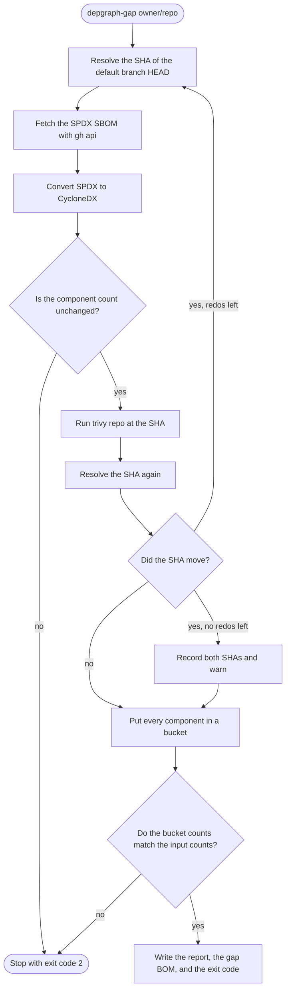
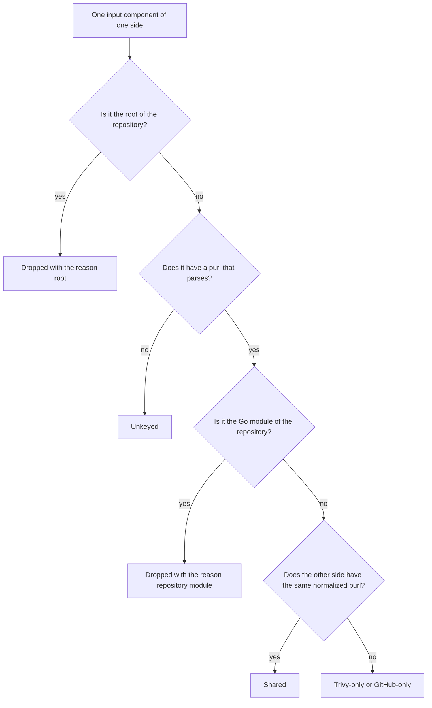

# depgraph-gap

`depgraph-gap` finds the ecosystems that GitHub Dependabot and GitHub Advanced Security do not cover in a repository.

The tool compares two inventories of one repository at the HEAD commit of the default branch.
The first inventory is the GitHub dependency graph.
The second inventory is the output of Trivy.
If Trivy finds components in an ecosystem and GitHub finds none, the tool flags the ecosystem as **uncovered**.

## Usage

Before you start, finish the setup in the [root README](../../README.md).
You need `gh`, `trivy`, and `cyclonedx` on your `PATH`.
You also need `GITHUB_TOKEN` in your environment.

To compare a repository, run the tool from this directory.

```sh
uv run depgraph-gap owner/repo
```

The tool supports `github.com` only.
It prints the JSON report on stdout and a summary on stderr.
To keep the report, redirect stdout.

```sh
uv run depgraph-gap owner/repo > report.json
```

### Options

- `--emit-gap-bom PATH` writes a CycloneDX BOM of the components that only Trivy found.
- `--fail-on-diff` exits with code 1 when either side has a component that the other side lacks.

### Exit codes

- **0:** The run finished. This is also the code when the sides differ and you did not set `--fail-on-diff`.
- **1:** The sides differ and you set `--fail-on-diff`.
- **2:** An error stopped the run. Examples are a missing tool, an unset `GITHUB_TOKEN`, a disabled dependency graph, or a broken invariant.

If the dependency graph of the repository is disabled, GitHub answers the SBOM request with a 404.
The tool then exits with code 2 and says that the dependency graph is probably disabled.

### Report

The JSON report has these top-level keys, in this order.

- `repository` is the `owner/repo` string.
- `run` holds every attempt with the SHA before and after, the drift flag, the drift warning, and the tool versions.
- `accounting` holds the bucket counts for each side, with the dropped components split by reason.
- `ecosystems` holds the summary for each purl type, with the `uncovered` flag.
- `uncovered_ecosystems` lists the purl types that are uncovered.
- `version_mismatches` lists the packages that both sides have with different versions.
- `packages` holds the detail for every bucket. Each dropped component carries its reason.

## Pipeline



The tool redoes the whole run up to 3 times when the SHA moves.
A run has 4 attempts at most.
If the SHA still moves after the last attempt, the tool records both SHAs in the report.
The tool also prints a warning.

## Bucket model

The tool puts every input component of each side in exactly one bucket.



- **Shared:** Both sides have the normalized purl.
- **Trivy-only:** Only Trivy has the normalized purl.
- **GitHub-only:** Only GitHub has the normalized purl.
- **Unkeyed:** The component has no purl, or the purl does not parse. The tool lists these components for each side and never compares them.
- **Dropped:** A component that describes the repository itself. Each dropped component has a reason.
  - **`root`:** The root of the BOM. Trivy puts it in `metadata.component`. GitHub lists it as `pkg:github/owner/repo`.
  - **`repository_module`:** The Go module of the scanned repository. Trivy lists it as a component without a version. For example, `pkg:golang/github.com/owner/repo`.

The tool keeps one entry for each normalized purl and counts the occurrences.
The tool drops no component except the two kinds above.
A side can have more than one dropped component.

### Repository module rule

The tool drops a component as the `repository_module` only when both conditions hold.

1. The purl type is `golang`.
2. The normalized module path is `github.com/owner/repo`, optionally followed by a major-version suffix `/v2` or higher.

The tool compares the owner and the repository name case-insensitively.
The tool applies the rule to both sides, whatever the version of the purl.
The tool does not match any other path, so `github.com/owner/repo/internal` stays in its bucket.

The major-version suffix follows the real data.
On `ulule/limiter`, Trivy lists the module as `pkg:golang/github.com/ulule/limiter/v3`.
Go requires this suffix for module versions `v2` and higher, and forbids `/v1`.
Without the suffix rule, the module of such a repository would stay visible as a trivy-only package.

### Lossless invariant

For each side, the bucket counts must add up to the input component count.
The report shows the sum in `accounting`.
The summary on stderr prints one line for each side.
For `magnusp/openbao-seal-spire`, the lines are these.

```text
github: 93 in = 81 shared + 11 only + 0 unkeyed + 1 dropped (1 root, 0 repository module)
trivy: 85 in = 81 shared + 1 only + 1 unkeyed + 2 dropped (1 root, 1 repository module)
```

If the sum differs, the tool stops with exit code 2.
The `Comparison` type checks this rule when the code creates it, so no code path can skip the check.

The tool also compares the component count before and after the SPDX to CycloneDX conversion.
The tool stops with exit code 2 on any difference.

### Version mismatch

A version mismatch is a package that both sides list with different versions.
The report lists these in `version_mismatches`.
The components also stay in their trivy-only and github-only buckets.
A version mismatch never makes an ecosystem uncovered.

### Normalization

The tool normalizes each purl before it compares purls.

1. Decode percent-encoding.
2. Lowercase the type.
3. Lowercase the namespace and the name for the types `bitbucket`, `composer`, `github`, `githubactions`, `golang`, `npm`, and `pypi`.
4. Replace runs of `-`, `_`, and `.` in a `pypi` name with a single `-`.
5. Drop qualifiers and subpaths.

## Trivy flags

The tool runs this command.

```sh
trivy repo https://github.com/owner/repo --commit SHA \
  --format cyclonedx \
  --detection-priority comprehensive \
  --include-dev-deps \
  --scanners vuln \
  --quiet \
  --output FILE
```

- `--format cyclonedx` writes a CycloneDX BOM that lists every package.
- `--detection-priority comprehensive` lists more packages than the default `precise`. On `magnusp/watermill-coordinator` it added the Go `stdlib` package. The count went from 34 to 35.
- `--include-dev-deps` adds development dependencies for npm, Yarn, and Gradle. It did not change the count on `magnusp/watermill-coordinator`, a Go repository.
- `--scanners vuln` skips the secret scanner. On `magnusp/watermill-coordinator`, the scanner choice did not change the count of 34 packages.
- `--quiet` hides the progress output.

The tool passes `GITHUB_TOKEN` through to Trivy in the environment.

## Why the diff is in Python

The tool uses `cyclonedx convert` to convert SPDX to CycloneDX.
The tool does not use `cyclonedx diff`, because the command does not match components on the purl.

The prototype ran on 2026-10-15 with `cyclonedx` 0.33.1 and Trivy 0.75.0.
It compared the real inventories of `magnusp/watermill-coordinator` and `magnusp/openbao-seal-spire`.
It also compared a pair of small hand-written BOMs.

- **No purl matching.** With `--component-versions`, `cyclonedx diff` groups components by `name`. A hand-written BOM A had `pkg:npm/foo@1`, `pkg:pypi/foo@1`, and a repeat of `pkg:npm/foo@1`. BOM B had only `pkg:npm/foo@1`. The command reported all three components as `unchanged` under the name `foo`. The `pypi` package that BOM B lacks looked matched.
- **Names split purls that are equal.** On `magnusp/watermill-coordinator`, GitHub named a module `github.com/ThreeDotsLabs/watermill` and Trivy named it `github.com/threedotslabs/watermill`. The purls are identical. `cyclonedx diff` reported one removed name and one added name. A purl-keyed Python diff matched them.
- **No default output.** Without `--component-versions`, the command printed nothing for text output and `{}` for JSON output, although the BOMs differed.
- **No ecosystem grouping.** The output has no purl type, so the tool would have to parse every purl in Python to build the summary.
- **No accounting.** The output does not partition the input. The tool could not check the lossless invariant from it.

The Python diff keeps the invariant and produces the grouping by purl type, so it replaces the command.

## Known limits

- Trivy with `--detection-priority comprehensive` also lists the Go `stdlib` package, for example `pkg:golang/stdlib@v1.24.0`. GitHub did not list it on any repository that the prototype checked. A Go repository with no dependencies has no other `golang` component on either side. The tool still flags `golang` as uncovered for such a repository.
- Trivy lists a package once for each lockfile that names it. The occurrence count of the same purl can differ between the sides.
- GitHub builds the SBOM from the default branch. The tool cannot pin the SBOM to a commit. The drift check only detects a branch that moves during the run.
- The dependency graph of a repository can be disabled. For example, `magnusp/graceful-spring` answered with a 404 on 2026-10-15.

## Develop

Run the unit tests from this directory.

```sh
uv run pytest
```

The live smoke test runs the real `gh`, `trivy`, and `cyclonedx` binaries.
It is off by default.
To run it, set `GITHUB_TOKEN` and select the `live` marker.

```sh
uv run pytest -m live
```

The test asserts a clean exit and a balanced accounting for each side.
It asserts no package counts.
To pick another repository, pass `--live-repo owner/repo`.
The default repository is `magnusp/openbao-seal-spire`.

## Possible follow-ups

- Add a `renovate.json` coverage check. The check would compare the ecosystems that this tool finds with the managers that the `renovate.json` of the repository enables.
- Decide how to treat the Go `stdlib` package that Trivy lists. This would remove the false `golang` gap for a repository without dependencies.
